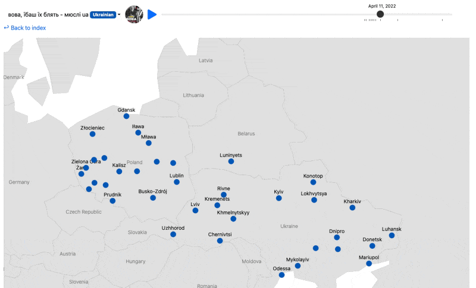

This repo contains code for the paper "**Unsettled Times: Music Discovery Reveals Divergent Cultural Responses to War**". To reproduce our analyses you will need some or all of these files.

> All data and materials are publicly archived at [OSF](https://osf.io/ra38k), with the exception of song lyrics data which belongs to the relevant right holders. All analysis scripts are available and maintained at <https://github.com/harin-git/mus-war>.

Please contact us if you run into any issues.

## Interactive visualizations

Interactive visualizations of figures in the paper can be found on [our website](https://musicdiscover.net)

## Downloading the data

For faster performance, we recommend manually downloading all datasets (folders "Bootstraps" and "Dataset") from the OSF repository by following [this link](https://osf.io/ra38k/?view_only=32795758b14040cdb826d743023308fd). Once downloaded, unzip the folders and place them in the main working directory alongside the analysis scripts.

You can also run `Rscript download_data.R` from the repository root to fetch data from OSF using the [osfr](https://cran.r-project.org/web/packages/osfr/vignettes/getting_started.html) R package. The script downloads once, including saved bootstrap outcomes by default. To download only Dataset, change the single call to `download_data(bootstrapped_data = FALSE)`. Run it before the `Dataset/` or `Bootstraps/` folders exist; the helper refuses to overwrite existing folders. Note, this can be slow depending on your region.

## Reproducing the analyses and plots

All analyses in the paper can be reproduced with the code posted here, in R and Python. Most computations use bootstrap simulations, which can be computationally costly. Pre-computed bootstrap files can be downloaded by calling `download_data(bootstrapped_data = TRUE)` in `download_data.R`. They belong in the `Bootstraps/` directory.

Scripts to reproduce the statistics and plots of the main results are contained in the directory `/Analysis`, while secondary scripts for validation, extracting embeddings, etc are included in sub-directory `/Analysis/Extra`

When running all analyses and reproducing the figures, `SIMULATION` parameter in the scripts can be set to `FALSE` to bypass the bootstrap computation. Given the bootstrap data is downloaded, it will fetch the pre-computed bootstrap outcomes.

All analysis scripts begin by loading study-wide packages and high-level functions through `utils.R`. Install the packages used by the relevant scripts before running them. See `session_info.txt` for the original analysis environment.

## Codebook

### General

`nodeID` = unique identifier given to city

`trackID` = unique identifier given to song

`pre_post` = whether the dates are pre or post-invasion period (reference date = 2022-02-24)

`source` & `target` = used to identify the undirected and directed relations between cities (nodes). Corresponds to nodeID

`weight` = strength of the edge, defined by the frequency it appears in bootstraps

### Semantic features

`embedding` = word vectors extracted from Open AI embedding

`lyrics_language` = identified language of lyrics using [fasttext](https://fasttext.cc/docs/en/language-identification.html)

### Acoustic features

\*Full description of acoustic features can be found at [Essentia website](https://essentia.upf.edu/algorithms_reference.html).

`loudness` = EBU R128 loudness descriptors of an audio signal

`dynamic_complexity` = average absolute deviation from the global loudness level estimate on the dB scale

`spectral_complexity` = number of peaks in the input spectrum

`spectral_centroid` = the centroid is computed by dividing the norm of the resulting signal by the norm of the input signal. The centroid is given in hertz

`spectral_energy` = energy ratio of the specified band over the total energy

`zcr` = number of sign changes between consecutive signal values divided by the total number of values

`bpm` = beats per minute

`onset_rate` = number of onsets per second and their position in time for an audio signal

`chord_change_rate` = rate at which detected chords change

`major_minor` = detected major or minor key

`mfcc` = mel-frequency cepstrum coefficients of a spectrum by taking means across 12 bins
